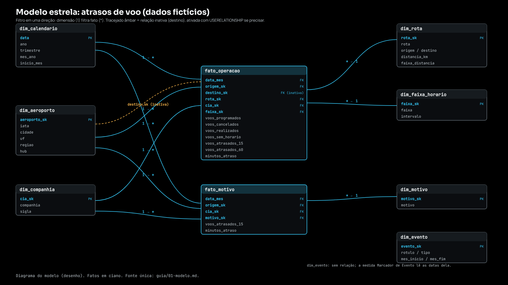

# 01 · O modelo estrela

> Dados fictícios (semente 20261106). Diagrama: `previas/modelo-diagrama.png` (desenho, não captura do Power BI).

## A ideia em uma frase

Duas tabelas de fatos (o que aconteceu, contado), cercadas por dimensões (os eixos pelos quais o leitor corta). Todo filtro nasce numa dimensão e desce para o fato, em uma direção só.

## Tabelas

| Tabela | Tipo | Grão (o que é uma linha) | Linhas | Chave |
|---|---|---|---:|---|
| `fato_operacao` | fato | mês × rota × companhia × faixa de horário | 93.597 | sem chave própria; 6 FKs |
| `fato_motivo` | fato | mês × aeroporto de origem × companhia × motivo do atraso | 22.150 | sem chave própria; 4 FKs |
| `dim_calendario` | dimensão | um dia (2023-01-01 a 2025-12-31) | 1.096 | `data` |
| `dim_aeroporto` | dimensão | um aeroporto (24 cadastrados; 19 aparecem como origem) | 24 | `aeroporto_sk` |
| `dim_companhia` | dimensão | uma companhia (todas fictícias) | 5 | `cia_sk` |
| `dim_faixa_horario` | dimensão | uma faixa do dia (madrugada, manhã, tarde, noite) | 4 | `faixa_sk` |
| `dim_rota` | dimensão | um par origem-destino (um sentido) | 150 | `rota_sk` |
| `dim_motivo` | dimensão | um motivo informado de atraso | 7 | `motivo_sk` |
| `dim_evento` | dimensão solta | um evento fictício (greve, tempestade, obras, falha de registro) | 4 | `evento_sk` |

Os 6,2 milhões de voos individuais ficam fora do modelo e fora do Git (`dados/bruto/voos.parquet`, gerado por `scripts/gerar_dados.py`). O Power BI carrega só os fatos agregados (5 MB).

## Relações (todas 1 → *, filtro em uma direção)

| De (lado 1) | Para (lado *) | Ativa? | Observação |
|---|---|---|---|
| `dim_calendario[data]` | `fato_operacao[data_mes]` | sim | ver "O calendário diário com fato mensal" |
| `dim_calendario[data]` | `fato_motivo[data_mes]` | sim | idem |
| `dim_aeroporto[aeroporto_sk]` | `fato_operacao[origem_sk]` | sim | aeroporto = ORIGEM do voo |
| `dim_aeroporto[aeroporto_sk]` | `fato_operacao[destino_sk]` | **não** | papel de destino; ative numa medida com `USERELATIONSHIP` se precisar |
| `dim_aeroporto[aeroporto_sk]` | `fato_motivo[origem_sk]` | sim | |
| `dim_companhia[cia_sk]` | `fato_operacao[cia_sk]` e `fato_motivo[cia_sk]` | sim | |
| `dim_faixa_horario[faixa_sk]` | `fato_operacao[faixa_sk]` | sim | `fato_motivo` não tem faixa |
| `dim_rota[rota_sk]` | `fato_operacao[rota_sk]` | sim | |
| `dim_motivo[motivo_sk]` | `fato_motivo[motivo_sk]` | sim | |

`dim_evento` não tem relação: a medida `Marcador de Evento (série)` lê as datas dela. `Etapas` e `Param Volume Minimo` (tabelas de `dax/auxiliares.dax`) também ficam soltas, de propósito.

## Decisões de desenho (e o que cada uma evita)

1. **Fato guarda somas e contagens, nunca taxas.** `voos_atrasados_15` e `voos_realizados` somam; a taxa é uma razão calculada na medida. Guardar a taxa faria o total errado (média de médias).
2. **Atraso só existe onde há horário.** `voos_sem_horario` é coluna do fato: sem ela, o denominador da taxa estaria errado e a falha de registro ficaria invisível.
3. **Dois fatos, não um.** O motivo do atraso só existe para voo atrasado e tem outro grão; misturar no mesmo fato exigiria muita linha vazia. A conferência garante que a soma de atrasados dos dois fatos é igual (identidade 4 em `02-medidas.md`).
4. **Chaves substitutas (`*_sk`).** Inteiros curtos no fato; o nome mora na dimensão. Renomear uma companhia não mexe no fato.
5. **Dimensão de aeroporto com papel duplo.** Origem ativa, destino inativa: uma relação ativa só, sem ambiguidade de caminho.
6. **Sem relação bidirecional.** Nenhuma. Filtro só desce da dimensão para o fato; é o que mantém as medidas previsíveis.

## O calendário diário com fato mensal

O fato está no grão mensal e cada linha cai no **dia 1** do mês (`data_mes`). O calendário é **diário e contínuo**, porque as funções de tempo (`SAMEPERIODLASTYEAR`, `EDATE`/`EOMONTH`) exigem datas contíguas e a tabela precisa ser marcada como tabela de datas.

Consequência a conhecer: se alguém colocar o **dia** num eixo, só o dia 1 de cada mês terá valor. Por isso os visuais usam `mes_ano` (ordenado por `inicio_mes`) e nenhum usa `dia`. Oculte as colunas de dia do calendário; ele tem só `data`, `ano`, `trimestre`, `mes_num`, `mes_abrev`, `mes_ano`, `ano_mes` e `inicio_mes`.

## Configuração no Power BI (resumo; passo a passo em `04-montagem.md`)

- `dim_calendario`: marcar como tabela de datas, coluna `data`; classificar `mes_ano` por `inicio_mes` e `mes_abrev` por `mes_num`.
- Ocultar da visão de relatório as chaves (`*_sk`, `data_mes`) e as colunas de soma dos fatos (use só as medidas).
- Resumo padrão das colunas numéricas dos fatos: "Não resumir".
